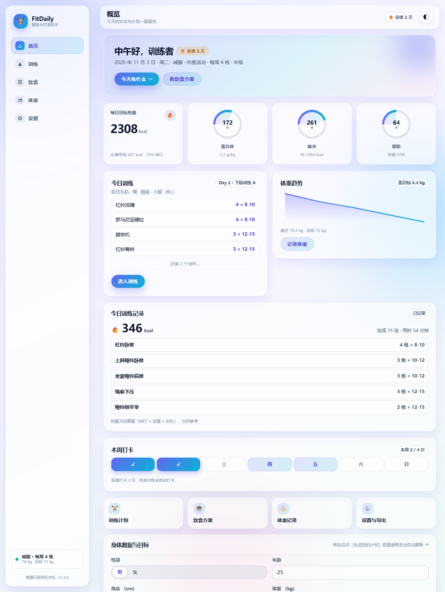
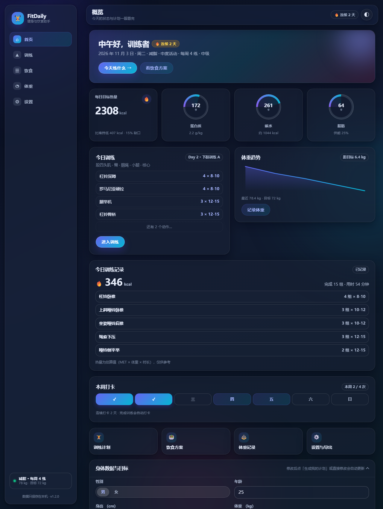
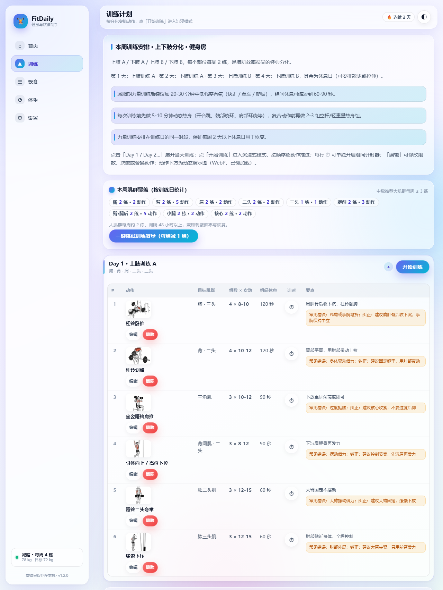
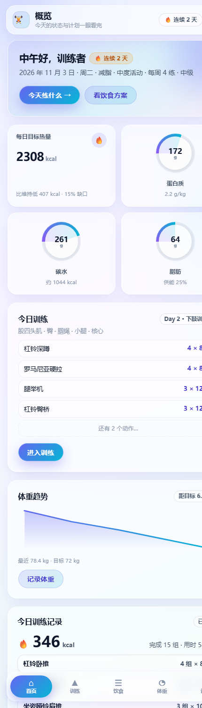
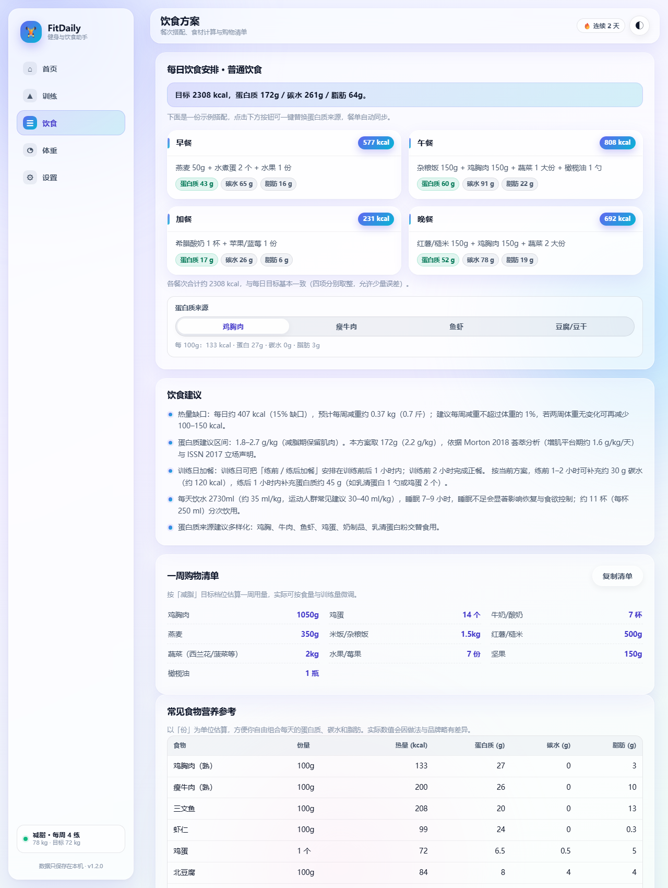
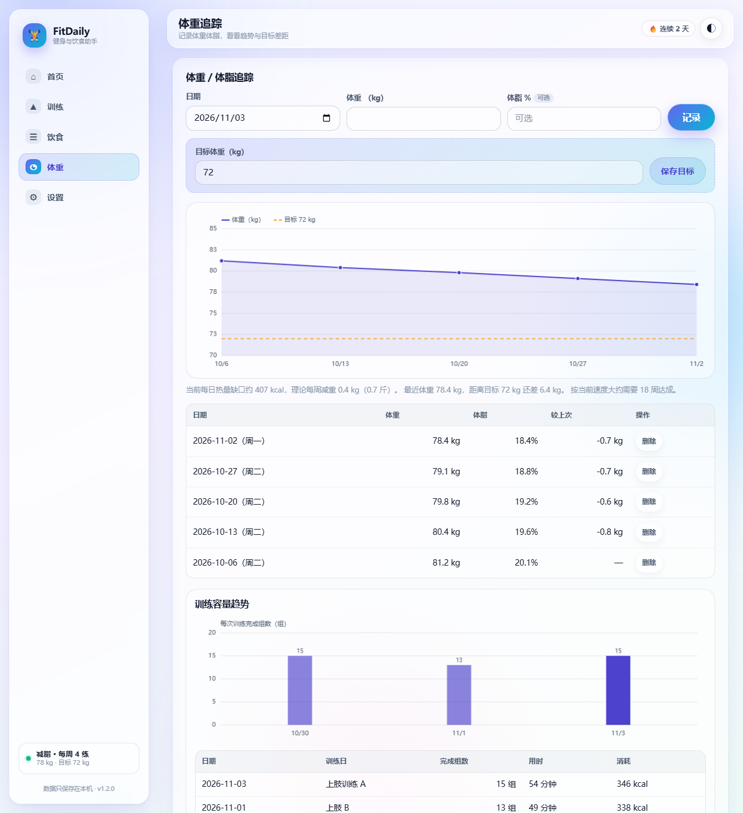
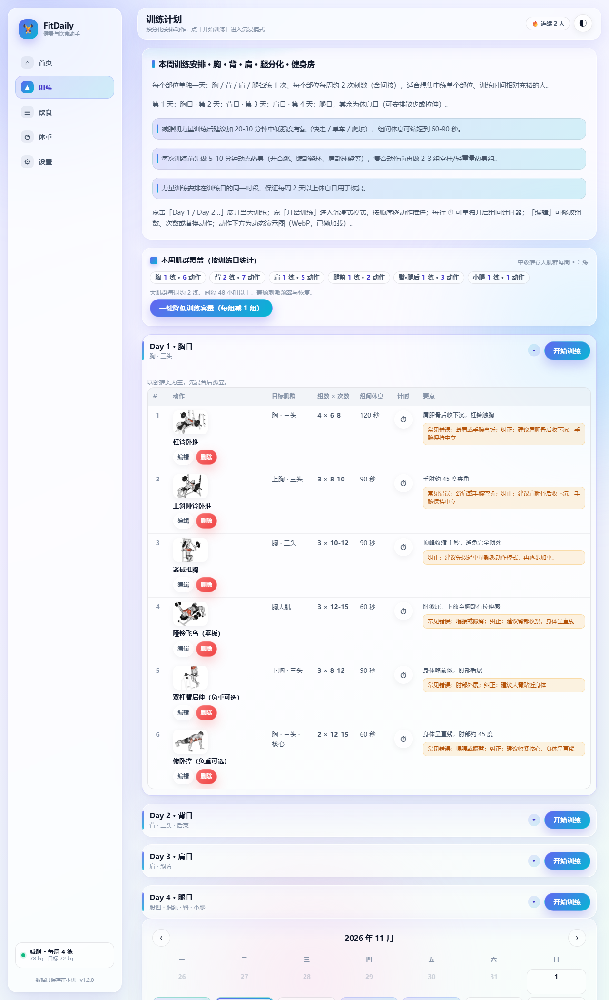
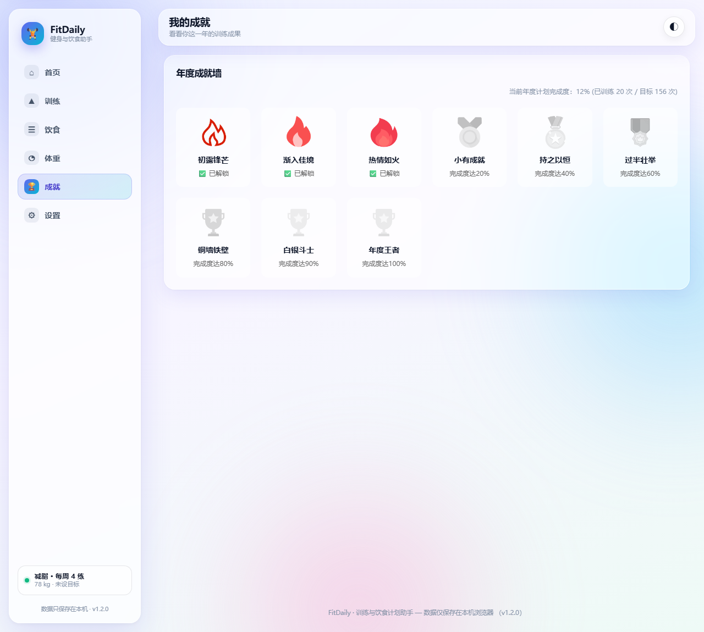

# FitDaily · 健身与饮食计划助手（v1.3）

一个**纯前端、零依赖、无需安装**的健身与饮食计划工具：输入身体数据与目标，自动生成每日热量与三大营养素、按每周训练天数与分化生成的训练计划、每日饮食安排、体重与训练记录、年度成就墙。

> 🔗 **在线使用**：<https://vigour762.github.io/fit-daily/>　（手机打开后「添加到主屏幕」即可当 App 用）
> 📦 **代码仓库**：<https://github.com/ViGour762/fit-daily>

> 本项目是对公开站点 [FitPlan](https://lihua2779.github.io/fit-plan/)（源码：[lihua2779/fit-plan](https://github.com/lihua2779/fit-plan)）的**功能复刻**：数据、算法、功能与目标站一致，代码为重新实现；在此基础上增加了**今日训练记录（动作清单 + 热量估算）**、**四天「胸·背·肩·腿」分化**与**年度成就系统**。
>
> UI 已完全重做：从「白底绿卡」改为**柔和渐变玻璃拟态（Glassmorphism）**，信息架构重构为桌面左侧边栏 + 移动底部浮岛导航 + 首页仪表盘。
>
> 所有数据只保存在**本机浏览器 localStorage**，不上传任何服务器。

---

## 界面预览

<p align="center">
  
  
</p>

<p align="center">
  
  
</p>

<p align="center">
  
  
</p>

<p align="center">
  
  
</p>

---

## 功能一览

| 模块 | 功能 |
| --- | --- |
| **首页仪表盘** | 问候与日期、目标热量 + 三大营养素环形图、今日训练清单、**今日训练记录（练了哪些动作 + 完成组数/用时 + 估算消耗 kcal）**、体重趋势、本周打卡、快捷入口；无计划时显示引导卡 |
| **计划生成** | 性别 / 年龄 / 身高 / 体重 / 体脂率（可选）/ 器械 / 活动水平 / 目标 / 每周天数 / 经验 / 饮食偏好；热量缺口滑杆实时联动 |
| **训练计划** | 按「器械 × 每周天数」匹配分化（2 天全身 / 3 天推拉腿 / **4 天可选「上下肢」或「胸·背·肩·腿」** / 5 天推拉腿+上下肢 / 6 天推拉腿 A-B 轮换）；每天 4–6 个动作，含组数 × 次数、组间休息、动作要点、常见错误与纠正；40 张动作演示动图懒加载 |
| **训练操作** | 训练日折叠；**沉浸式训练模式**逐组推进并记录；每行独立**组间计时器**（60/90/120/150s，结束提示音）；动作编辑与删除 |
| **训练记录** | 完成训练自动记录：日期、训练日、完成动作与组数、用时、估算消耗；写入 `state.sessions` 并自动打卡 |
| **容量管理** | 本周肌群覆盖统计 + 新手推荐提示；「一键降低训练容量」开关（每组 −1，下限 2 组） |
| **训练日历** | 月历排布训练日、今天高亮、点击打卡、连续打卡天数；日程提醒（周几/时间/提前 15·30·60 分钟）+ 导出 `.ics` |
| **成就系统** | 年度成就墙：按年度目标 156 次训练的完成度解锁 9 枚徽章（火焰 → 奖牌 → 奖杯），显示完成度与已训练次数；桌面侧栏与手机底部导航均有入口 |
| **饮食方案** | 每日三餐 + 加餐（按饮食偏好 × 目标生成）、蛋白质来源切换、饮食建议、一周购物清单（复制） |
| **食物库** | 22 种常见食物营养表；食材计算器；自定义食材（每 100g 营养，自动算热量） |
| **体重追踪** | 记录体重/体脂（同日覆盖）、目标体重与目标虚线、体重曲线、距目标差距与预计周数；训练量趋势柱状图 + 训练记录（完成组数 / 用时 / 消耗 kcal） |
| **设置与数据** | 深浅主题、字号、kg/斤、cm/英尺、饮水提醒、打印 PDF、CSV、ICS、JSON 备份导入导出、一键清空；PWA 离线 |
| **移动端** | 底部浮岛导航（6 项：首页/训练/饮食/体重/成就/设置）、表格折叠为卡片、图表自适应、安全区适配 |
| **PWA** | 可安装到桌面（Android Chrome「安装应用」/ iOS Safari「添加到主屏幕」），离线可用 |

---

## 快速开始

### 方式一：直接用线上版（推荐给手机）

打开 <https://vigour762.github.io/fit-daily/> → 手机浏览器菜单里「安装应用 / 添加到主屏幕」。

### 方式二：VS Code 本地开发

1. 用 VS Code 打开本目录：`code .`
2. 按 `Ctrl+Shift+B`（或「终端 → 运行任务」）选择 **「启动本地预览（http://127.0.0.1:5173）」**
3. 浏览器打开 <http://127.0.0.1:5173/>
4. 调试：按 `F5` 选择 **「调试 FitDaily（Chrome）」**（会自动先启动本地服务器）

### 方式三：命令行

```bash
npm run dev        # 启动本地预览 http://127.0.0.1:5173
npm test           # 全部自动化测试（算法 / 训练数据 / 营养 / 集成冒烟）
npm run check:css  # 检查 HTML/JS 中用到的 class 是否都有样式
```

### 方式四：直接双击 `index.html`

可直接用浏览器打开（离线可用）。注意 Service Worker（PWA 离线缓存、添加到主屏幕）只在 `http://` / `https://` 下生效。

---

## 计算与统计口径

| 项 | 规则 |
| --- | --- |
| 基础代谢 BMR | Mifflin-St Jeor（1990）：男 `10×kg + 6.25×cm − 5×age + 5`；女 `… − 161`；填写体脂率时改用 Katch-McArdle：`370 + 21.6 × 瘦体重` |
| 每日总消耗 TDEE | BMR × 活动系数（久坐 1.2 / 轻度 1.375 / 中度 1.55 / 高度 1.725 / 极高 1.9） |
| 目标热量 | 减脂 `TDEE × (1 − 缺口%)`（默认 15%，可调 10–20%）；增肌 `TDEE × (1 + 盈余%)`（默认 12%，可调 5–15%）；保持 = TDEE |
| 蛋白质 | 减脂 2.2 g/kg（推荐 1.8–2.7）、增肌 1.8 g/kg（1.6–2.2）、保持 1.6 g/kg（1.4–2.0） |
| 脂肪 | 占总热量约 25%（推荐 20–35%）；碳水由剩余热量补齐 |
| 饮水 | 体重 × 35 ml（30–40 ml/kg 区间） |
| 每周变化 | 减脂约 `缺口×7/7700` kg 且不超过体重 1%/周；增肌不超过 0.5%/周 |
| 训练消耗（估算） | `kcal ≈ MET × 3.5 × 体重(kg) / 200 × 训练分钟`；MET 按动作取 3.5–6.5（深蹲/硬拉等复合动作更高），按完成组数加权平均；没有时长的老记录按每组约 1.6 分钟估算。仅作参考 |
| 成就完成度 | `state.sessions` 的条数（每完成一次训练 +1）÷ 年度目标 **156 次**（≈ 每周 3 练），上限 100% |

> 计算链路（未取整 BMR → TDEE → 目标热量）与上游站点逐项对齐，`tests/nutrition.test.js` 直接用上游参考值做断言。参考文献见页面「设置 → 数据依据」。

---

## 数据与存储

- 主状态：`localStorage['fitdaily-state']`（一个 JSON，含 profile / settings / schedule / weights / sessions / checkins / overrides 等）
- 首屏与提醒：`fitdaily-theme`、`fitdaily-font`、`fitdaily-train-notify`、`fitdaily-train-lastnotify`
- 兼容旧版：首次打开会自动把 `fitplan-*` 旧键迁移到 `fitdaily-*`
- 备份：设置页 → 导出 JSON；换手机 / 清缓存后可在同页导入恢复
- 隐私：无后端、无账号、无上报，所有数据只在本机浏览器

---

## 目录结构

```
fit-app/
├── index.html                # 页面骨架：侧边栏 / 顶栏 / 6 个视图 / 3 个浮层 / 底部浮岛导航
├── css/
│   ├── shell.css             # 设计令牌、背景光斑、外壳、通用组件、首页仪表盘、响应式、打印
│   └── views.css             # 训练 / 饮食 / 体重 / 成就 / 设置 视图 + 三个浮层的业务样式
├── js/
│   ├── data.js               # 训练数据：66 个动作、40 张演示图、gym/home × 2–6 天模板 + 四分化模板
│   ├── nutrition.js          # 营养数据：22 种食物、4 偏好 × 3 目标餐单、购物清单
│   ├── core.js               # 纯算法层（无 DOM，可被 Node 直接测试）：热量、营养、容量、MET 热量
│   ├── dashboard.js          # 首页仪表盘渲染（含今日训练记录）
│   ├── training.js           # 训练页 + 日历 + 提醒 + 沉浸训练 + 计时器 + 训练记录
│   ├── diet.js               # 饮食页 + 食物库 + 计算器 + 自定义食材
│   ├── weight.js             # 体重追踪 + 训练量趋势（canvas 手绘）
│   ├── achievements.js       # 年度成就墙（徽章 / 完成度）
│   ├── settings.js           # 设置 / 导出 / 备份 / 清空
│   └── app.js                # 应用外壳：状态与持久化、导航、表单、渲染调度
├── img/                      # 40 张动作演示动图（webp）+ 成就徽章 + PWA 图标
├── scripts/                  # 零依赖本地服务器、图标生成、CSS 覆盖检查、演示图下载
├── tests/                    # 算法 / 训练数据 / 营养数据 / 集成冒烟（共 86 项断言）
├── docs/
│   ├── design-v2.md          # 设计规范（令牌、布局、组件、仪表盘 DOM）
│   ├── api.md                # FP 前端 API 与模块契约
│   └── spec-nutrition.md     # 营养算法规格与差异说明
├── .vscode/                  # 本地任务、调试配置（已 gitignore，不入库）
└── manifest.webmanifest / sw.js / version.txt
```

**数据流**：`index.html` 静态骨架 → `app.js` 载入 `state`（localStorage `fitdaily-state`）→ 生成计划时调用 `core.js` 计算 → `dashboard / training / diet / weight / achievements / settings` 各自渲染容器；任何写操作后 `FP.save()` 持久化并 `FP.renderAll()` 重绘。

**技术栈**：原生 HTML + CSS + ES5 JavaScript（IIFE 模块挂全局 `FP`），零依赖、无构建；PWA（manifest + Service Worker）；图表用 canvas 手绘；数据持久化用 localStorage。

---

## 测试与校验

```bash
npm test           # 86 项：core 29 / data 18 / nutrition 14 / smoke 25
npm run check:css  # 271 个 class 覆盖检查
```

---

## 部署与更新

线上站点通过 **GitHub Pages** 部署，仓库 `main` 分支根目录即站点内容。

- 更新流程：本地修改 → `git add` → `git commit -m "feat: …"` → `git push` → 约 1 分钟后自动部署
- 查看部署：仓库 **Actions → pages build and deployment**
- **改了 CSS/JS 后**：把 `sw.js` 里的 `CACHE_NAME` 改成新值（如 `fitdaily-shell-20261105`）再推送，避免用户拿到旧缓存
- 其他部署方式：Netlify Drop（整个目录拖到 <https://app.netlify.com/drop>）、局域网 `npm run dev` 后手机访问 `http://<本机IP>:5173`

---

## 已知限制

- **数据不跨设备同步**：没有账号和服务器，每台设备数据独立；换手机用设置页的 JSON 备份迁移
- **后台计时**：沉浸训练/组间计时在锁屏或切后台时可能暂停（网页固有限制）
- **通知**：iOS 上 PWA 的提醒能力有限；桌面浏览器通知需授权
- **成就目标固定**：年度目标 156 次写死在 `js/achievements.js` 的 `ANNUAL_GOAL`，需要可自行修改
- **热量与训练消耗均为估算**：基于通用公式，不能替代专业设备或医学建议

---

## 更新记录

### v1.2（2026-11）

- 新增**年度成就系统**：9 枚徽章、完成度进度、桌面侧栏 + 手机底部导航双入口
- 新增**今日训练记录**：练了哪些动作、完成组数、用时、估算消耗 kcal
- 新增**四天「胸·背·肩·腿」分化**：4 天训练可在「上下肢」与「胸背肩腿」之间选择
- 训练记录补充用时与消耗；体重页训练记录表增加「消耗」列
- 品牌更名为 **FitDaily**，存储键迁移为 `fitdaily-*`（旧数据自动迁移）
- 上线 GitHub Pages，支持手机「添加到主屏幕」离线使用；清理误提交的压缩包

### v1.0（2026-10）

- 完成对上游 FitPlan 的功能复刻：计划生成、训练、饮食、体重、日历、导出
- 全新玻璃拟态 UI + 仪表盘首页 + 侧边栏 / 浮岛导航

---

## 免责声明

本工具基于通用健身营养学原理估算，仅供学习与参考，**不能替代医生或注册营养师的建议**。如有慢性病、饮食障碍或特殊情况，请在开始训练与调整饮食前咨询专业人士；训练中如有疼痛请立即停止。

## 致谢与许可

- 训练动作数据、文案与演示动图参考自上游公开项目 [FitPlan](https://github.com/lihua2779/fit-plan)，版权归原作者，公开分发前请自行确认素材授权
- 本项目代码为独立实现，可自由参考与修改
